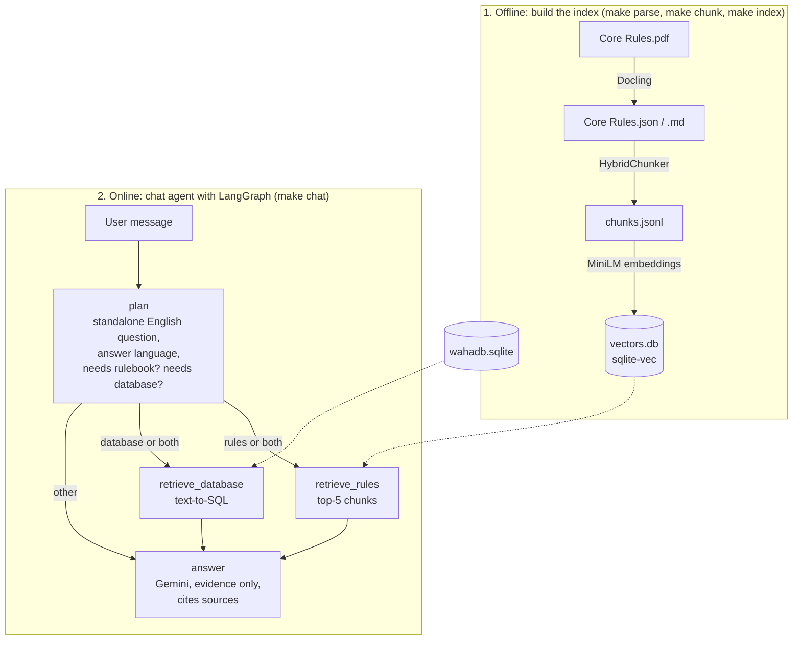

# Warhammer 40,000 Multi-Channel RAG Chatbot

A terminal chatbot that answers questions about the Warhammer 40,000 tabletop game from two sources: the **Core Rules book** (60-page PDF), searched with embeddings, and a **SQLite database of units** (`wahadb.sqlite`: datasheets, characteristics, weapons, abilities, keywords, stratagems, points...), queried with SQL written by the LLM. For each message, a LangGraph agent chooses the source, remembers the conversation, answers in the user's language and cites its sources.

Course project RAGLAB1 (Retrieval-Augmented Generation). The key design choices, the problems we met and the evaluation results are in **[REPORT.md](REPORT.md)**.

## Architecture



1. **Offline (once):** the rulebook is parsed, split into chunks and indexed.
2. **Online (each message):** the `plan` step decides whether the message needs the rulebook, the unit database, both (the two retrievals then run in parallel) or neither (route `other`). The `answer` step writes the answer from the retrieved evidence only.

The reasons for this design are explained in [REPORT.md](REPORT.md).

## Versions

Version 1 is the minimal result we set as a goal; version 2 is the next round of features.

**Version 1: MVP (this submission)**
- Rulebook channel: Docling parsing, structure-aware chunks, MiniLM embeddings, vector search with sqlite-vec.
- Database channel: text-to-SQL on a read-only connection, with one automatic retry when a query fails.
- Chat: routing to one channel or to both at once (e.g. the Move of a unit and the Advance rule), multi-turn memory, answers in the user's language (and translation on request), sources under each answer.
- Evaluation of the rulebook channel with RAGAS.

**Version 2 (next)**
- Fix the reading order of multi-column pages, by re-ordering the elements of each page with their positions in the Docling JSON.
- For the route `both`, split the question into one sub-question per channel, instead of using the same question for the vector search and the SQL query.
- Evaluate the database channel and the route `both`: hand-written questions with a reference answer (and a reference SQL query), and the accuracy of the routing.
- Improve the two weakest scores: a re-ranker for the order of the retrieved chunks, and more concise answers.

**Future versions**
- An agent that decides step by step which source to query next, for questions where the answer of one source decides what to look up in the other (e.g. a unit's weapons, then the rule for Pistols).
- A multilingual embedding model, instead of rewriting every question in English.
- A richer interface (e.g. Textual) with streamed answers.
- A conversation memory that survives a restart (persistent checkpointer).
- A larger and more varied test set, judged by a stronger model.

## Repository layout

```
├── Makefile                 shortcuts for every command (make chat, make index...)
├── REPORT.md                design decisions and evaluation analysis
├── .env.example             template for the API key (.env itself is never committed)
├── data/
│   ├── raw/                 Core Rules.pdf (not in git, only needed to parse again)
│   ├── tables/              wahadb.sqlite (not in git) and SQL_AGENT_DATA_DICTIONARY.md
│   ├── processed/           parsed rulebook (Core Rules.json, Core Rules.md), chunks.jsonl,
│   │                        vectors.db (built locally, not in git)
│   └── eval/                RAGAS test set, agent answers and scores
└── src/
    ├── raglab1/             the library
    │   ├── settings.py      every parameter, each one can be overridden in .env
    │   ├── parser/          Docling PDF parser
    │   ├── chunker/         HybridChunker, writes chunks.jsonl
    │   ├── storage/         embedder (MiniLM) and vector store (sqlite-vec)
    │   ├── llm/             Gemini client with rate limiting
    │   ├── retriever/       text retriever (vectors) and SQL retriever (text-to-SQL)
    │   ├── chatbot/         single-channel answering, used by the ask scripts
    │   ├── agent/           LangGraph chat agent: state, nodes, workflow
    │   └── evaluation/      RAGAS adapters, test set generation, scoring
    └── scripts/             entry points, one per command
```

**The parsed rulebook** is in `data/processed/`: `Core Rules.json` (DoclingDocument, with the page and position of every element), `Core Rules.md` (readable export) and `chunks.jsonl` (the chunks that are indexed).

## Setup

Requirements: [uv](https://docs.astral.sh/uv/) (it installs Python 3.13 if needed) and a free API key from [Google AI Studio](https://aistudio.google.com/apikey).

1. Clone the repository and install the dependencies:

   ```bash
   git clone https://github.com/joyce22-nichijou/multichannel-rag-chatbot.git
   cd multichannel-rag-chatbot
   uv sync --group eval            # or: make install
   ```

   The `eval` group adds RAGAS. Without `--group eval`, only the chatbot dependencies are installed.

2. Copy `.env.example` to `.env` and paste your API key into it.

3. Copy `wahadb.sqlite` (provided with the course) into `data/tables/`. Heavy files (PDF, SQLite) are kept out of git.

4. Build the vector index. The first run downloads the embedding model.

   ```bash
   uv run python src/scripts/index.py      # or: make index
   ```

5. Start the chat:

   ```bash
   uv run python src/scripts/chat.py       # or: make chat
   ```

Parsing the PDF is slow, so the parsed rulebook and the chunks are committed: steps 4 and 5 are enough. To run the whole pipeline again, put `Core Rules.pdf` into `data/raw/`, then run `make parse`, `make chunk` and `make index`.

**On Windows:**

- `make` is not installed by default. Install it with `winget install ezwinports.make`, or run the `uv run` commands below directly.
- If the model download fails with `WinError 1314`, Hugging Face cannot create symbolic links: enable Developer Mode in the Windows settings.

## Commands

| make | uv command | What it does |
|---|---|---|
| `make install` | `uv sync --group eval` | install the dependencies, RAGAS included |
| `make parse` | `uv run python src/scripts/parse.py` | PDF → Docling JSON + Markdown |
| `make chunk` | `uv run python src/scripts/chunk.py` | Docling JSON → `chunks.jsonl` |
| `make index` | `uv run python src/scripts/index.py` | chunks → embeddings in `vectors.db` |
| `make search Q="..."` | `uv run python src/scripts/search.py "..."` | show the retrieved chunks and their scores, without calling Gemini |
| `make ask Q="..."` | `uv run python src/scripts/ask.py "..."` | answer one question from the rulebook only |
| `make ask-sql Q="..."` | `uv run python src/scripts/ask_sql.py "..."` | answer one question from the database only, and show the SQL |
| `make chat` | `uv run python src/scripts/chat.py` | multi-turn chat with routing |
| `make testset` | `uv run --group eval python src/scripts/generate_testset.py` | generate the RAGAS test set |
| `make eval` | `uv run --group eval python src/scripts/evaluate.py` | ask the agent every test question and score the answers |

`make testset` refuses to overwrite an existing test set: add `ARGS="--force"` to regenerate it. `make eval ARGS="--limit 3"` evaluates only the first 3 questions, which is useful for a quick test. Both commands use many Gemini calls.

## Using the chat

Type a question in any language. Answers cite the rulebook page, e.g. (p. 14), or the unit, e.g. (unit database: Intercessor Squad). Under each answer, the chat shows the route, the standalone English question and the sources: rulebook pages and headings, the SQL query and its number of rows, or both. `/new` starts a new conversation and `/quit` exits.

Examples to try:

- rules: `How does the Benefit of Cover work?`
- database: `Which Aeldari units have toughness 4?`
- both: `What is the Move of the Intercessor Squad, and how far can it move when it Advances?`
- a follow-up that needs the memory: after a question about a unit, `What is its save?`
- translation: ask a question in French, then `Translate your answer into English.`

## Configuration

Every parameter is in `src/raglab1/settings.py` and can be overridden in `.env` with its name in upper case, for example `LLM_MODEL=gemini-3.6-flash`.

| Variable | Default | Meaning |
|---|---|---|
| `GOOGLE_API_KEY` | (required) | Google AI Studio key |
| `LLM_MODEL` | `gemini-3.5-flash-lite` | Gemini model used for routing, SQL, answers and RAGAS |
| `LLM_REQUESTS_PER_MINUTE` | `10` | rate limit for the free tier |
| `RETRIEVAL_K` | `5` | chunks retrieved per question |
| `CHUNK_MAX_TOKENS` | `256` | maximum chunk size, the limit of the embedding model |
| `CHAT_HISTORY_TURNS` | `5` | previous turns given to the LLM |
| `SQL_MAX_ROWS` | `50` | maximum rows of a SQL result given to the LLM |
